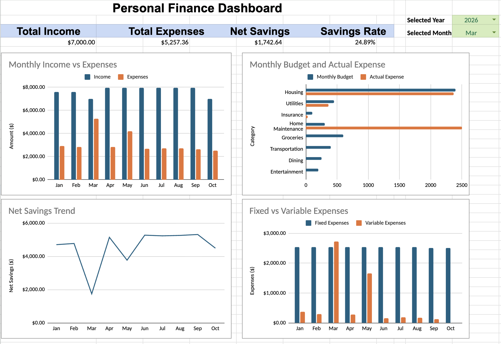

# Personal Finance Analytics

An end-to-end data analytics project that transforms raw financial transaction data into actionable insights using **Snowflake, SQL, and Google Sheets**.

The project demonstrates a complete analytics workflow from raw data ingestion and validation through transformation, KPI development, trend analysis, and dashboard visualization.

## Project Overview

The objective of this project is to analyze income and spending patterns and answer key financial questions such as:

- How are income, expenses, and savings changing over time?
- Which expense categories contribute the most to total spending?
- What are the major drivers behind unusually high-expense months?
- How do fixed and variable expenses compare?
- How is the savings rate changing month over month and year over year?

## Architecture

```text
CSV Source Data
      ↓
Snowflake RAW Layer
      ↓
Data Validation
      ↓
Snowflake ANALYTICS Layer
      ↓
SQL Business Analysis
      ↓
Dashboard & Insights
```

### Snowflake Structure

```text
PERSONAL_FINANCE_DB
│
├── RAW
│   └── TRANSACTIONS
│
└── ANALYTICS
    ├── MONTHLY_SUMMARY
    ├── CATEGORY_SPENDING
    ├── FIXED_VARIABLE_SPENDING
    └── MONTHLY_TRENDS
```

The **RAW** schema preserves source-level transaction data, while the **ANALYTICS** schema contains reusable transformed views designed for reporting and analysis.

## Technologies Used

- Snowflake
- SQL
- Google Sheets
- CSV
- GitHub

## Data Model

The transaction dataset contains fields including:

- Transaction Date
- Year
- Month
- Description
- Category
- Subcategory
- Transaction Type
- Payment Method
- Fixed / Variable
- Needs / Wants
- Amount

> **Privacy Note:** The repository contains synthetic sample data for demonstration purposes. Personal financial data used during development is not included.

## Data Validation

Before analysis, the raw dataset was validated by checking:

- Row counts
- Sample records
- Missing critical values
- Income and expense totals
- Numeric amount formatting

This step helped verify that the source data was loaded correctly before transformations were created.

## Analytics Layer

Reusable Snowflake views were created for common reporting requirements.

### Monthly Summary

Aggregates transactions by month and calculates:

- Total Income
- Total Expenses
- Net Savings

### Category Spending

Aggregates monthly expenses by category to identify major spending drivers.

### Fixed vs Variable Spending

Separates monthly expenses into fixed and variable costs.

### Monthly Trends

Uses SQL window functions to compare monthly expenses with the previous month and calculate month-over-month percentage changes.

## SQL Techniques Demonstrated

The analysis uses:

- `SUM()` and other aggregations
- `CASE WHEN`
- `GROUP BY`
- Common Table Expressions (CTEs)
- Window functions
- `LAG()`
- `RANK()`
- `PARTITION BY`
- `QUALIFY`
- `NULLIF()`
- Date functions
- Conditional aggregation
- Month-over-month analysis
- Year-over-year analysis

## Key KPIs

The dashboard tracks:

**Total Income | Total Expenses | Net Savings | Savings Rate**

Savings Rate is calculated as:

```text
Net Savings / Total Income × 100
```

## Key Insights

Analysis of the development dataset identified several notable patterns:

- Housing represented approximately **82% of total expenses** across the analyzed development data.
- **March 2026** recorded the highest monthly expenses at approximately **$5.26K**, primarily driven by a **$2.50K Home Maintenance expense** in addition to regular housing costs.
- **September 2026** recorded the highest net savings at approximately **$5.31K**, supported by higher income while expenses remained controlled.
- From **2025 to 2026**, income increased approximately **6.81%**, while expenses decreased approximately **5.81%**.
- As a result, annual net savings increased approximately **17.57%** year over year.
- The annual savings rate improved from **53.96% in 2025 to 59.40% in 2026**, an increase of **5.44 percentage points**.

> 2024 contains only a partial year of data and therefore was not used for direct full-year performance comparisons with 2025.

## Dashboard

The dashboard provides an interactive view of financial performance with year and month selectors.



The dashboard includes:

- Monthly Income vs Expenses
- Budget vs Actual Expenses
- Net Savings Trend
- Fixed vs Variable Expenses
- Year and Month filters

## Repository Structure

```text
personal-finance-analytics/
│
├── README.md
│
├── data/
│   └── sample_transactions.csv
│
├── sql/
│   ├── 01_create_database.sql
│   ├── 02_create_raw_table.sql
│   ├── 03_data_validation.sql
│   ├── 04_analytics_views.sql
│   └── 05_business_analysis.sql
│
└── dashboard/
    └── dashboard_screenshot.png
```

## Business Value

This project demonstrates how raw transaction-level data can be transformed into a structured analytics layer that supports financial monitoring and decision-making.

The workflow provides reusable datasets for identifying spending trends, detecting unusual expense periods, measuring savings performance, and understanding the categories driving overall costs.